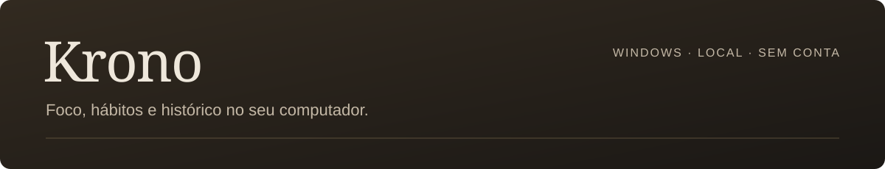
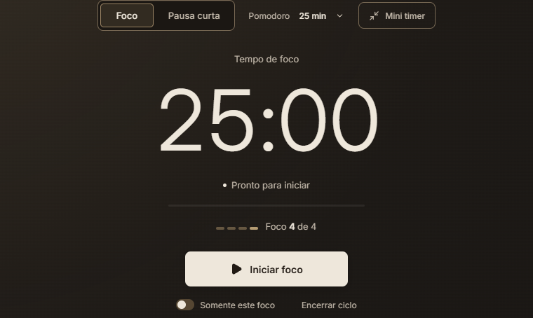

<p align="center">
  
</p>



Criei o **Krono** como um projeto pessoal, acreditando que ele poderia ser útil para quem estuda ou precisa de um Pomodoro integrado ao computador. Ele reúne sessões de foco, hábitos e histórico em um aplicativo que funciona localmente, sem exigir uma conta.

O Krono é desenvolvido com apoio de ferramentas de IA, com testes e ajustes a partir do uso real. Eu conduzo as decisões sobre as funções, o design e a experiência do aplicativo.

## Durante o estudo

Você escolhe o tempo de foco e as pausas, inicia a sessão e pode acompanhar o restante pelo mini timer. Fechar a janela pode manter o Krono na bandeja; sair do aplicativo encerra sua execução.

Um foco pode ser vinculado a um hábito de tempo. Os hábitos de ação têm conclusão manual, e cada rotina pode seguir dias específicos, dias úteis, todos os dias ou dias alternados. A revisão diária e a tela de Produção permitem consultar o que foi concluído, com metas opcionais e histórico das sessões.

**O tempo de pausa, as sessões interrompidas e o período com o aplicativo fechado não viram foco concluído.**

<p align="center">
  
</p>
<p align="center">
  <sub>Captura do aplicativo com dados de demonstração.</sub>
</p>

## Um espaço que acompanha seus focos

O **Jardim de foco** é uma função opcional em **beta, ainda em construção**. Um pequeno personagem cuida do cenário durante o foco, e o tempo concluído libera os capítulos Jardim, Pátio, Biblioteca e Observatório.

Os lugares anteriores continuam disponíveis para visita. Não há perda de progresso por ausência. A arte, as animações e a progressão ainda vão receber melhorias.

## Seus dados ficam no computador

O aplicativo não exige cadastro, não sincroniza registros com servidores e não envia telemetria. Não há serviços de IA em execução dentro do Krono.

Em Ajustes, você pode salvar um backup local ou exportar o histórico em CSV. Restaurar um backup substitui o histórico atual; os arquivos de backup não são criptografados. Os dados ficam separados da pasta de instalação e são preservados por padrão ao desinstalar.

## Instalação

A plataforma suportada é **Windows 11 x64**. Os instaladores ficam nas [releases do projeto](https://github.com/gusynth/Krono/releases/latest). A instalação não exige Node.js.


## Rodar a partir do código

No Windows 11 x64, com **Node.js 24.19 ou superior da série 24** e Git instalados:

```powershell
npm ci
npm run setup
npm run dev
```

O ambiente de desenvolvimento usa um perfil próprio em `.test-data/development`, separado da instalação normal.

Para gerar os arquivos do aplicativo sem instalar:

```powershell
npm run build
```

Os requisitos de compilação, os comandos de teste e a geração de pacotes estão em [Compilar e testar](docs/building.md). Uma visão curta da organização está em [Arquitetura](docs/architecture-overview.md).

## Contribuir

Relatos de problemas, sugestões e correções são bem-vindos. Ao relatar um erro, descreva o que fez, o que esperava e a versão utilizada. Não envie seu banco de dados ou backup pessoal em uma issue pública.

Veja [como contribuir](CONTRIBUTING.md) e [como relatar um problema de segurança](SECURITY.md).

## Licença

O código-fonte é distribuído sob a [licença MIT](LICENSE). O nome, o símbolo e as artes do Krono têm [termos próprios](ASSETS_LICENSE.md). Fontes e dependências mantêm suas [licenças originais](THIRD_PARTY_NOTICES.md).

<sub>Projeto pessoal de <a href="https://github.com/gusynth">gusynth</a>.</sub>
